# Elastic SOC Lab

## Overview

This lab focused on building a small SOC monitoring environment using the Elastic Stack.

The goal was to understand how security and application data moves from log sources into Elastic, how agents and integrations are managed, how incoming events can be processed, and how the collected data can be explored and visualized in Kibana.

During the lab, I deployed and configured Elasticsearch and Kibana, worked with Fleet and Elastic Agent, integrated Apache web server logs, created an ingest pipeline, collected custom logs, and visualized the resulting data.

---

## Lab Objectives

- Deploy and verify Elasticsearch
- Deploy and configure Kibana
- Configure Fleet Server
- Work with Elastic Agent
- Verify event ingestion in Kibana
- Integrate Apache HTTP Server logs
- Explore logs using Discover
- Work with ingest pipelines and processors
- Configure custom log collection
- Visualize collected data

---

## Technologies Used

| Technology | Purpose |
|---|---|
| Elasticsearch | Storage, indexing, and searching of collected events |
| Kibana | Data exploration, management, and visualization |
| Fleet | Centralized management of Elastic Agents and integrations |
| Elastic Agent | Collection and forwarding of telemetry and logs |
| Apache HTTP Server Integration | Collection of Apache access and error logs |
| Ingest Pipelines | Processing and transformation of incoming events |
| Custom Logs (Filestream) | Collection of custom log files |
| Kibana Discover | Searching and validating ingested events |
| Kibana Lens | Visualization of collected data |

---

# Lab Architecture

The lab demonstrated the basic flow of data through an Elastic monitoring environment:

```text
                    ┌─────────────────────┐
                    │     Log Sources     │
                    │                     │
                    │ Apache / Custom Logs│
                    └──────────┬──────────┘
                               │
                               ▼
                    ┌─────────────────────┐
                    │    Elastic Agent    │
                    │                     │
                    │ Collects telemetry  │
                    │ and log data        │
                    └──────────┬──────────┘
                               │
                               ▼
                    ┌─────────────────────┐
                    │    Elasticsearch    │
                    │                     │
                    │ Storage / Search /  │
                    │ Ingest Processing   │
                    └──────────┬──────────┘
                               │
                               ▼
                    ┌─────────────────────┐
                    │       Kibana        │
                    │                     │
                    │ Discover / Analysis │
                    │ / Visualization     │
                    └─────────────────────┘

                         Fleet Server
                              │
                              ▼
                     Elastic Agent
                       Management
```

This helped me understand that a SIEM is not only the interface used by an analyst. Multiple components are involved in collecting, processing, storing, searching, and presenting security data.

---

# 1. Deploying Elasticsearch

The first step was deploying Elasticsearch, which acts as the central storage and search component of the environment.

After configuring the service, I started Elasticsearch and verified that it was running successfully.

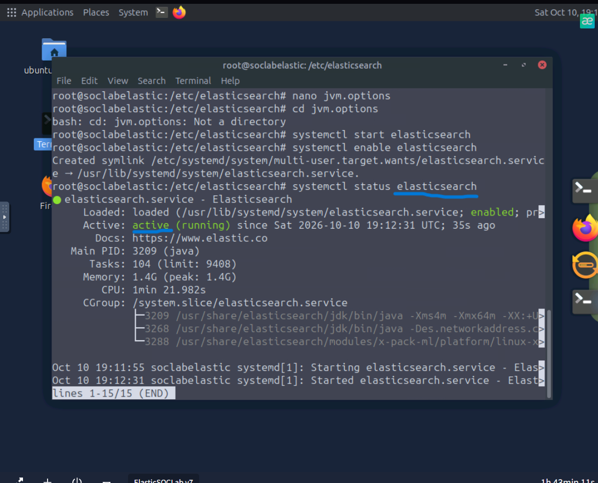

Checking the service status confirmed that Elasticsearch was active and ready for the rest of the Elastic Stack.

---

# 2. Deploying Kibana

Kibana was then deployed as the interface for interacting with the data stored in Elasticsearch.

After configuration, I verified that the Kibana service was running.

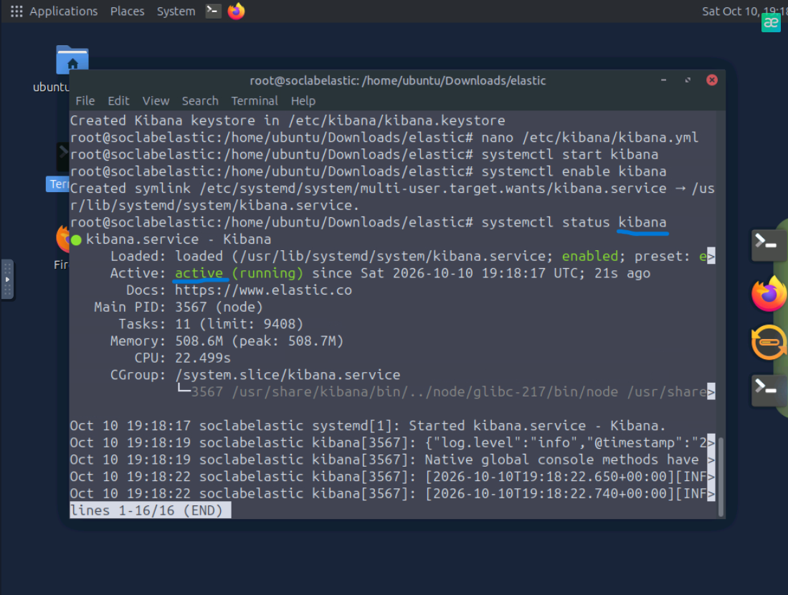

Once the initial setup was completed, I accessed the Kibana web interface successfully.

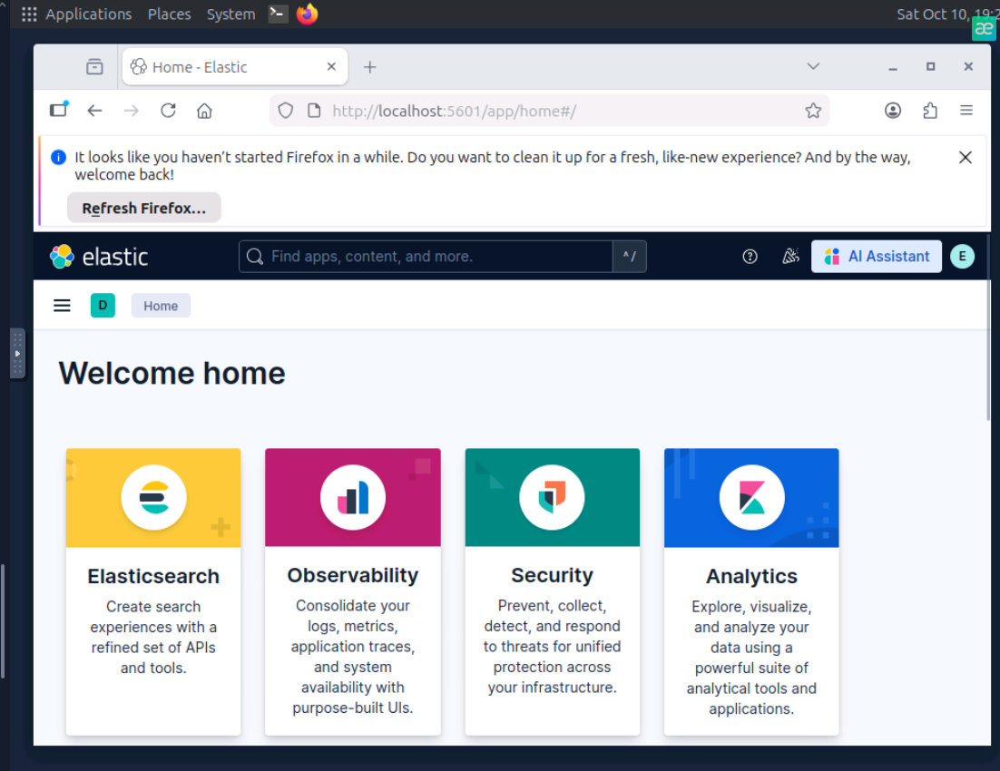

At this point, both the storage/search backend and the analyst-facing interface were operational.

---

# 3. Configuring Fleet Server

The next stage was configuring Fleet.

Fleet provides centralized management for Elastic Agents, their policies, and installed integrations.

A Fleet Server policy was configured and an agent was successfully associated with it.

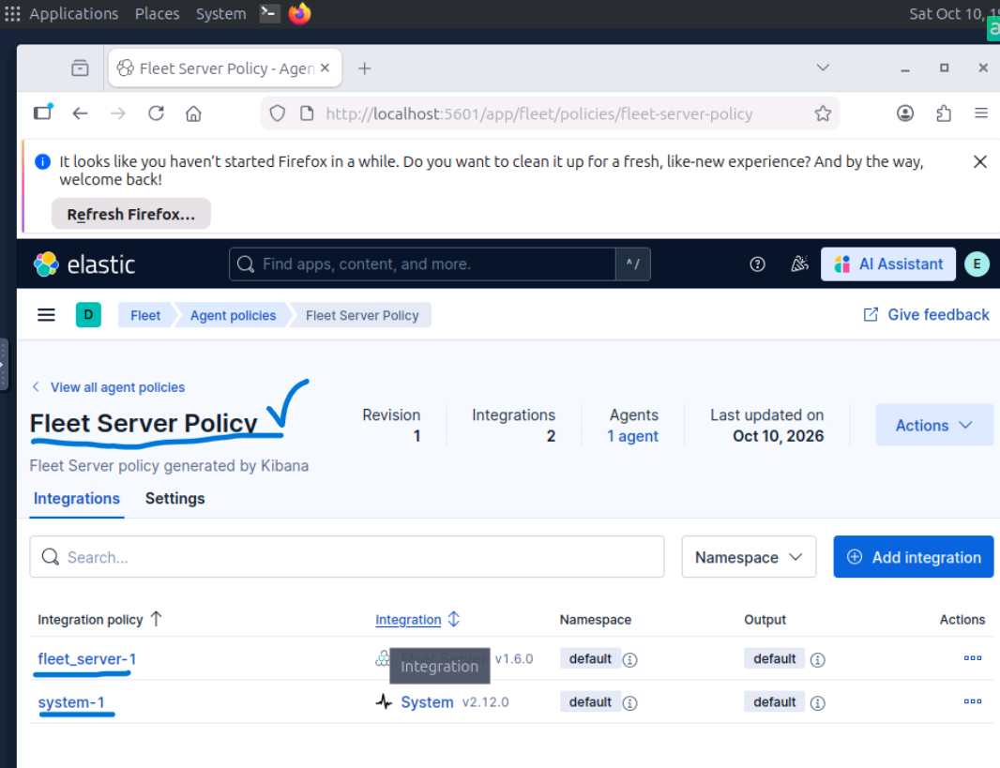

This introduced an important part of Elastic architecture: instead of configuring every data source independently, Fleet can centrally manage agent policies and integrations.

---

# 4. Collecting Data with Elastic Agent

After the agent was connected, I verified that telemetry was actually reaching Elastic.

Using Kibana Discover, I could see events generated by the Elastic Agent.

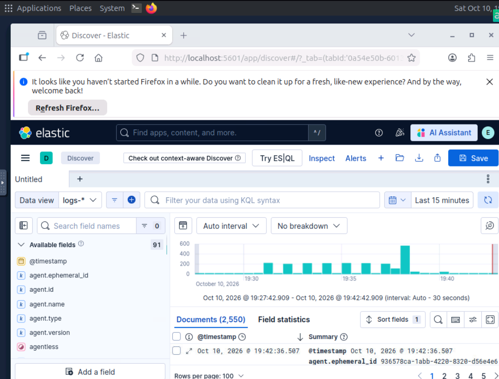

This was an important validation step.

Successfully installing an agent is not enough in a monitoring environment - the collected events must also be verified at the destination.

The basic data flow was now working:

```text
Elastic Agent
      │
      ▼
Elasticsearch
      │
      ▼
Kibana Discover
```

---

# 5. Integrating Apache HTTP Server Logs

The lab then introduced an additional log source using the Apache HTTP Server integration.

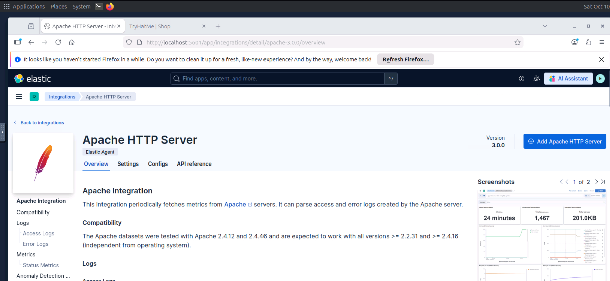

The integration provides a structured method for collecting Apache-related data instead of manually building the entire collection process.

After configuring the integration, I used Discover to confirm that Apache events were being ingested.

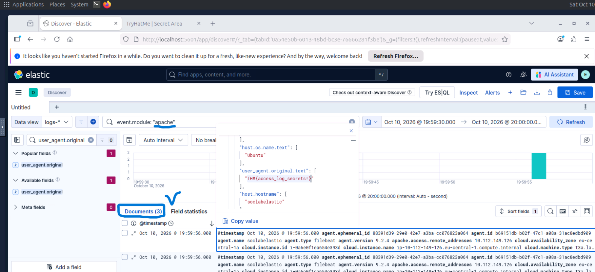

This demonstrated how integrations can extend visibility by bringing additional data sources into the same Elastic environment.

From a SOC perspective, web server logs can provide useful information about:

- client requests
- requested resources
- HTTP activity
- suspicious web requests
- scanning behavior
- potential exploitation attempts

---

# 6. Processing Events with Ingest Pipelines

Collecting logs is only part of the process.

Incoming data may also need to be parsed, transformed, or enriched before it becomes useful for analysis.

Elastic uses **ingest pipelines** to process documents before they are indexed.

I explored the available ingest pipelines and created a pipeline for processing incoming data.

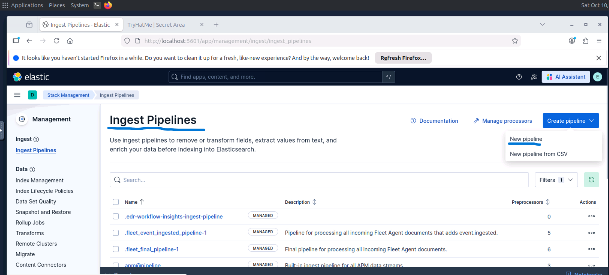

Processors define individual operations performed on events as they pass through a pipeline.

During the lab, I configured a processor to work with incoming log data.

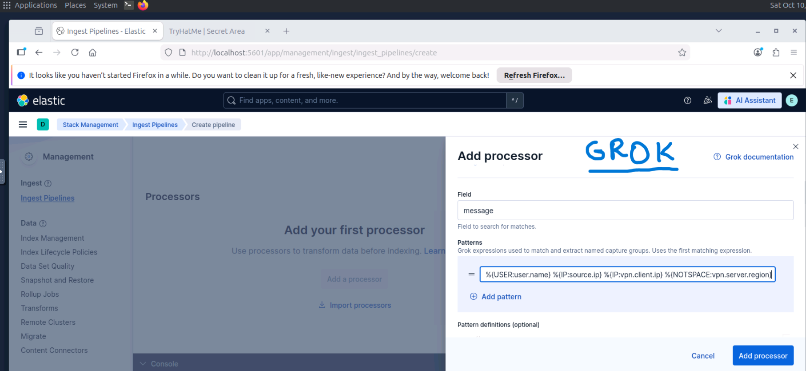

This helped demonstrate the difference between simply collecting raw logs and transforming those logs into structured, searchable information.

A simplified workflow looks like this:

```text
Raw Event
    │
    ▼
Ingest Pipeline
    │
    ▼
Processor
    │
    ▼
Processed Event
    │
    ▼
Elasticsearch Index
```

For SOC work, structured events make filtering, correlation, detection, and investigation significantly easier.

---

# 7. Collecting Custom Logs

Not every data source has a dedicated Elastic integration.

To understand how additional log sources can be onboarded, I configured the **Custom Logs (Filestream)** integration.

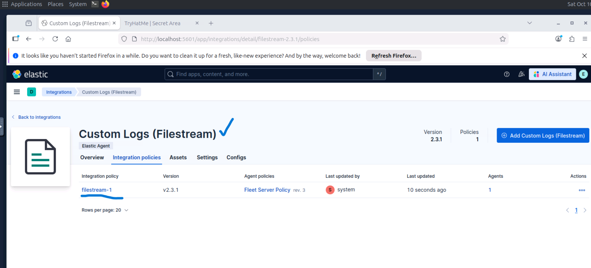

After configuring the integration, I verified the resulting events in Discover.

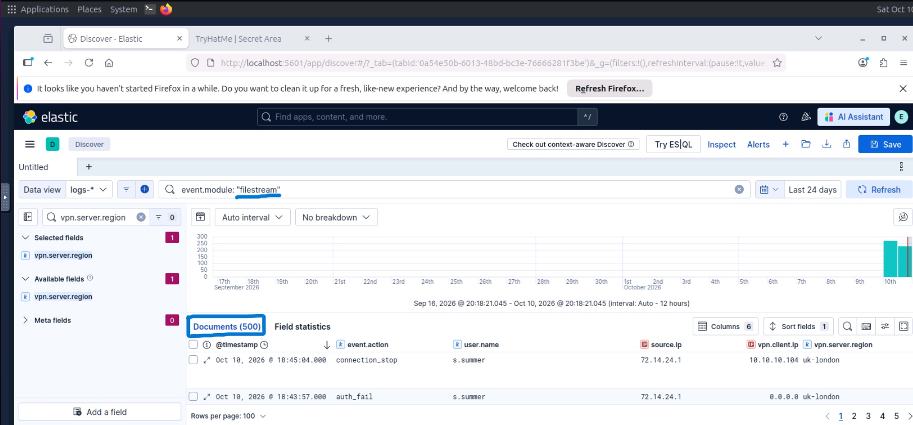

This demonstrated how Elastic can ingest logs outside of predefined integrations.

The workflow became:

```text
Custom Log File
      │
      ▼
Elastic Agent / Filestream
      │
      ▼
Elasticsearch
      │
      ▼
Kibana Discover
```

Being able to onboard custom data sources is particularly useful in SOC environments where organizations may use internal applications or uncommon technologies that do not have ready-made integrations.

---

# 8. Exploring and Validating Data

Throughout the lab, Kibana Discover was used to verify that data was successfully reaching Elastic.

This highlighted an important troubleshooting workflow:

```text
Configure Source
      │
      ▼
Collect Data
      │
      ▼
Search in Discover
      │
      ▼
Verify Fields and Events
```

Whenever a new integration or log source is added, verifying the resulting events helps confirm that the complete ingestion pipeline is functioning correctly.

---

# 9. Creating Visualizations

The final stage was using the collected data to create a visualization in Kibana.

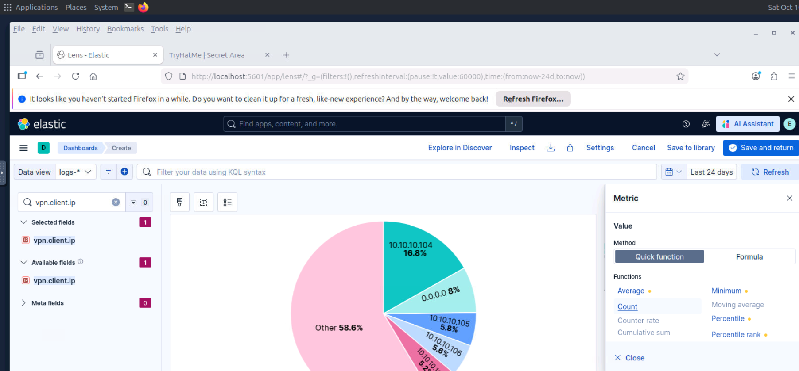

Visualizations provide another way to analyze event data and can help identify patterns that may not be immediately obvious when reviewing individual events.

In a SOC environment, visualizations can be useful for monitoring information such as:

- event volume
- source IP distribution
- authentication activity
- HTTP activity
- alert trends
- frequently observed hosts or users

---

# Data Flow Summary

By the end of the lab, I had worked with the main stages of an Elastic data pipeline:

```text
                  DATA SOURCES
                       │
          ┌────────────┴────────────┐
          │                         │
          ▼                         ▼
     Apache Logs               Custom Logs
          │                         │
          └────────────┬────────────┘
                       │
                       ▼
                 Elastic Agent
                       │
                       ▼
                Ingest Pipeline
                       │
                  Processing
                       │
                       ▼
                 Elasticsearch
                       │
                       ▼
                     Kibana
                       │
             ┌─────────┴─────────┐
             ▼                   ▼
          Discover          Visualizations
```

The most important takeaway was understanding the complete path of an event rather than viewing Kibana as an isolated SIEM interface.

---

# What I Learned

This lab helped me better understand the architecture behind an Elastic-based monitoring environment.

Key takeaways included:

- Elasticsearch provides the storage and search layer behind the environment.
- Kibana provides the interface used to explore, manage, and visualize the collected data.
- Fleet provides centralized management for Elastic Agents and integrations.
- Elastic Agent collects telemetry and log data from monitored systems.
- Integrations simplify onboarding common data sources such as Apache.
- Discover can be used to validate whether events are being ingested correctly.
- Ingest pipelines can transform incoming events before indexing.
- Processors perform individual transformations inside an ingest pipeline.
- Custom Logs (Filestream) can be used when a dedicated integration is not available.
- Visualizations can transform raw event data into information that is easier to monitor and interpret.

Most importantly, the lab helped connect the individual Elastic components into a single workflow:

```text
Collect → Process → Store → Search → Analyze → Visualize
```

---

# Security Notes

During deployment, Elastic may generate sensitive values such as:

- passwords
- enrollment tokens
- verification codes

These values should not be exposed in public documentation or committed to a public repository. (so there are no screenshots)

Sensitive setup information from the lab has therefore been intentionally excluded from this project.

---

# Conclusion

This lab provided hands-on experience building a small Elastic monitoring environment rather than only querying an already configured SIEM.

I deployed the core Elastic components, connected an Elastic Agent, integrated Apache logs, worked with ingest pipelines, onboarded custom log data, validated events in Discover, and created a visualization.

The project gave me a better understanding of how telemetry moves from a log source to a platform where a SOC analyst can search, investigate, and visualize it.

---

## Lab Source

This project was completed as part of hands-on training in the TryHackMe **Elastic: Setting up a SOC Lab** room.

The documentation focuses on the architecture, configuration workflow, and skills practiced during the lab rather than room answers.
